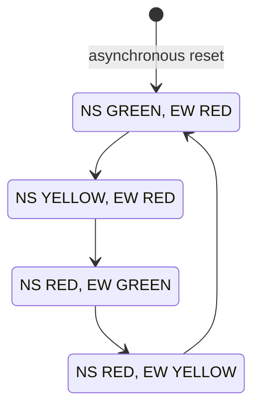

# FSM State Diagram

The reset transition is asynchronous and selects STATE 0 independently of the
clock. Once reset is released, each rising clock edge advances the controller
to the next state in the repeating sequence.